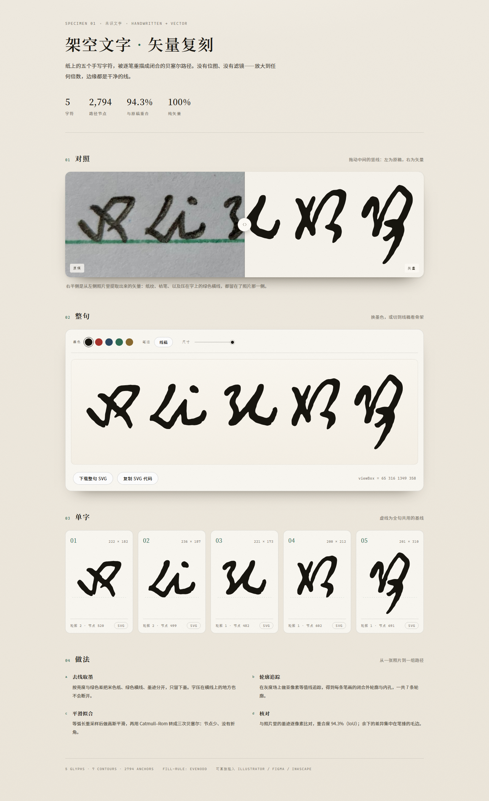

# 架空文字 · 矢量复刻

把一张手写稿上的 5 个字符，逐笔描成闭合的 SVG 路径。

## 在线预览

<https://letherchao.github.io/conlang-vector/>

## 文件

| 文件 | 说明 |
| --- | --- |
| `index.html` | 主页面，照片已内嵌，单文件也能独立打开 |
| `conlang-phrase.svg` | 整句矢量，透明背景 |
| `conlang-glyph-01.svg` ~ `05.svg` | 五个单字，各自独立 |
| `preview.png` | 页面截图 |

## 数据

- 5 个字符 / 7 条轮廓 / 2794 个贝塞尔锚点
- 与照片墨迹逐像素重合度 94.3%（IoU）
- 纯路径，无位图、无滤镜，可任意缩放

## 做法

1. 按亮度与绿色差分离墨迹与纸面绿线
2. 在灰度场上做亚像素等值线追踪，得到闭合轮廓
3. 等弧长重采样 + 高斯平滑 + Catmull–Rom 转三次贝塞尔
